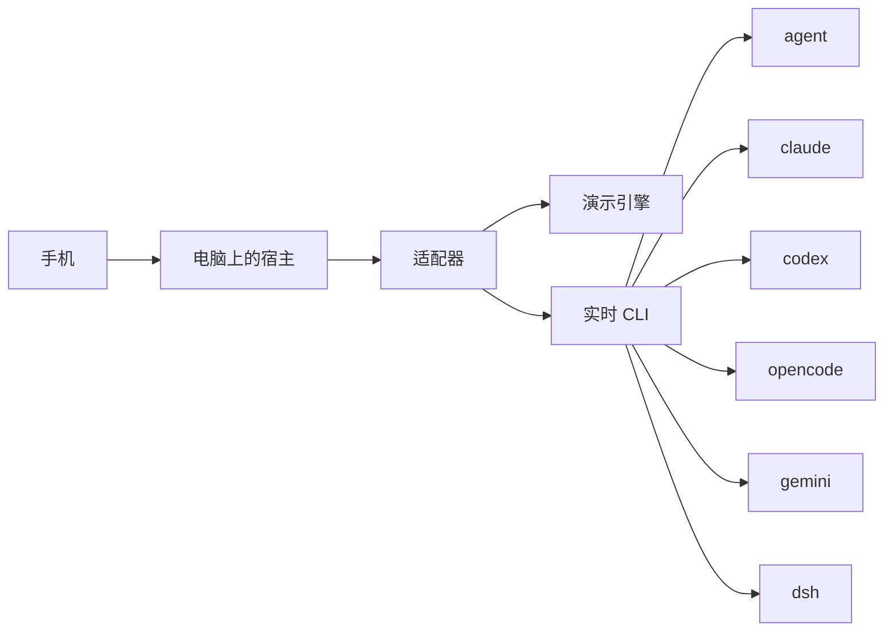

# MobileAgent

手机优先的多代理控制台。手机负责挑选和下指令；Cursor CLI、Claude Code、Codex、OpenCode、Gemini CLI 和 DeepSeek Harness 都跑在你的电脑上。输出再流回手机。

界面偏留白，浅色为默认，设置里可以换成深色。底部导航给手机用，宽屏会变成左侧导航。它不是 CloudCLI / Claude Code UI 的皮肤，也不包含那份代码。

VS Code 不是这里的代理平台。编辑器只是你自己的工具；MobileAgent 连接的是代理 CLI。

## 代理

| 适配器 | 命令 | 说明 |
| --- | --- | --- |
| Cursor CLI | `agent` | CloudCLI 开源注册表里的 cursor。实时模式跑 `agent -p`。 |
| Claude Code | `claude` | 实时模式跑 `claude -p --model`。 |
| Codex | `codex` | 实时模式跑 `codex exec --skip-git-repo-check`。模型以本机 Codex 配置为准。 |
| OpenCode | `opencode` | CloudCLI 开源注册表里的 opencode。实时模式跑 `opencode run`。 |
| Gemini CLI | `gemini` | CloudCLI 托管文档列出的线路。实时模式跑 `gemini -p -m`。 |
| DeepSeek Harness | `dsh` | 不是普通的 DeepSeek 对话接口。实时模式跑 `dsh --profile headless`。模型写在 dsh 配置档里（示例：`deepseek-v4-pro`、`deepseek-v4-flash`）。 |

默认是演示模式：六条线路都有样例项目、会话、文件和队列。手机和这台开发机都不需要先装 CLI。关掉演示模式后，电脑上的宿主会探测命令，并在你选中的目录里启动对应 CLI。

新的代理实现 `AgentAdapter`（`packages/agent-core/src/hub.ts`），在创建 Hub 之前调用 `registerAdapter`。内置名单来自 `packages/agent-core/src/catalog.ts`。

## 架构

手机不安装这些 CLI。电脑上跑一个宿主（`apps/bridge`），界面可以装在手机上，也可以由宿主自己提供。

```text
手机浏览器 / PWA
        │  局域网地址 + 配对码
        ▼
apps/bridge     电脑上的宿主。转发指令，把 CLI 输出流回手机
apps/web        Vite + React 界面
apps/desktop    Electron 壳，在本机启动宿主并打开窗口
packages/protocol     共享类型
packages/agent-core   可插拔适配器、演示引擎、实时 CLI 引擎
```



在手机上：选择代理，再用目录选择器挑电脑上的项目目录，然后发送消息。宿主把这段文字交给当前适配器，并把标准输出流式推回会话。六条内置线路走同一条路径。换代理只换适配器，不换手机上的操作。

密钥不会进仓库。环境变量优先；否则写到电脑上的 `~/.mobileagent/secrets.json`（权限 `0600`）。连接设置和浅色/深色偏好在 `~/.mobileagent/settings.json`，不含密钥。配对码在 `~/.mobileagent/host.json`。

## 在 Windows 上让手机连上电脑

把仓库放到 `D:\Project\MobileAgent`，目录就是仓库根目录。

```powershell
cd D:\Project\MobileAgent
npm install
npm run host
```

`npm run host` 会先构建，再让宿主监听 `0.0.0.0`。终端打印局域网地址和六位配对码。手机和电脑在同一网络时，用手机浏览器打开那个地址，输入配对码。配对码也显示在电脑本机打开的设置页里。本机访问 `127.0.0.1` 不需要填配对码。

之后手机上的流程：

1. 选择代理（Cursor CLI、Claude Code、Codex、OpenCode、Gemini CLI 或 DeepSeek Harness）。
2. 打开目录选择器，选电脑上的项目目录。演示模式下列出的是 `D:\Project\...` 样例；关掉演示模式后列出真实磁盘。
3. 在会话里发送文字。宿主在那个目录里启动对应命令，输出实时出现在手机上。

开发时想先看界面：

```powershell
npm run dev
```

界面在 `http://127.0.0.1:47231`，同一局域网可以用 `http://<电脑IP>:47231`。开发服务器把接口从这台电脑转发，方便试用。要让其他设备必须填写配对码，用 `npm run host`。

仓库根目录就是应用，之后可以推到自己的 GitHub 仓库（例如 AgentFrame）。按普通推送即可，不要对已有历史做 force-push。

## 本地运行

需要 Node.js 22 或更新版本。

```bash
npm install
npm run dev
```

- 界面：<http://127.0.0.1:47231>
- 宿主：<http://127.0.0.1:47232>

```bash
npm test
npm run build
npm start
```

`npm start` 由宿主托管已经构建的界面，默认只监听本机。`npm run host` 监听局域网并要求配对。

## 接上每条线路

先在设置里关掉演示模式，用目录选择器选好电脑上的项目目录，再按需要改命令路径。探测不到命令时，会话里会写明电脑上缺少哪条命令。手机不需要安装它。

### Cursor CLI

安装 Cursor CLI，让 `agent` 出现在 `PATH` 上。文档：<https://cursor.com/docs/cli/overview>。实时提示使用 `agent -p`。模型保持 `auto` 时不附加 `--model`。

### Claude Code

安装 Claude Code 并完成一次登录。文档：<https://docs.anthropic.com/en/docs/claude-code>。实时提示使用 `claude -p --model <model>`。可选环境变量 `ANTHROPIC_API_KEY`。

### Codex

安装 OpenAI Codex CLI 并登录。文档：<https://developers.openai.com/codex>。实时提示使用 `codex exec --skip-git-repo-check`。模型沿用 Codex 自己的配置，不从界面强行传 flag。可选环境变量 `OPENAI_API_KEY`。

### OpenCode

安装 OpenCode。文档：<https://opencode.ai>。实时提示使用 `opencode run`。模型沿用 OpenCode 的配置。

### Gemini CLI

安装 Gemini CLI。文档：<https://github.com/google-gemini/gemini-cli>。实时提示使用 `gemini -p -m <model>`。密钥读取 `GEMINI_API_KEY`，其次 `GOOGLE_API_KEY`。

### DeepSeek Harness

这是 DeepSeek 的开源 harness，命令是 `dsh`，不是裸的 chat completions。

```bash
npx @deepseek-ai/dsh web
```

上面这条会打开 Harness 自己的 Web UI。MobileAgent 在实时模式调用的是一轮任务：

```bash
dsh --profile headless "任务内容"
```

文档：<https://github.com/deepseek-ai/deepseek-harness>。把 `DEEPSEEK_API_KEY` 放在环境变量里，或在设置页保存到本机。端点会传给子进程的 `DEEPSEEK_BASE_URL`。模型由 dsh 配置档决定，界面里的模型名用来对照，例如 `deepseek-v4-pro` 和 `deepseek-v4-flash`。家目录是 `DSH_HOME`，默认 `~/.dsh`。

Windows 上如果 CLI 是 `.cmd` 垫片，把设置里的命令改成完整路径。

## 安装

### PWA

```bash
npm run build
npm start
```

用手机或电脑上的 Chrome / Edge 打开宿主地址，选「安装应用」。`apps/web` 在生产构建里带有 Web App Manifest。开发服务器不注册 service worker，避免把旧界面缓存住。

### Windows 安装包

在 Windows 上，于 `D:\Project\MobileAgent`：

```powershell
powershell -ExecutionPolicy Bypass -File .\scripts\package-windows.ps1
```

或者：

```bash
npm install
npm run desktop:dist:win
```

安装包在 `apps\desktop\release\MobileAgent-Setup-*.exe`（NSIS，可选安装目录）。Electron 会拉起桥接再打开窗口。签名默认关闭，方便在没有证书的机器上打包。

当前这台 Linux 环境可以先打未打包目录：

```bash
npm run desktop:dist
```

没有 Wine 时不要指望在 Linux 上产出 NSIS。脚本已经写好，换到 Windows 上跑即可。

### 桌面壳调试

```bash
npm run desktop
```

这会先构建界面和桥接，再用 Electron 打开。桌面壳使用端口 `47241`，避免和 `npm run dev` 冲突。

## 演示模式里有什么

- 总览：这台电脑、目录、当前代理，以及更换代理
- 会话：发到电脑上的指令，以及流回来的输出、工具轨迹、终端
- 项目：文件树、预览、演示用的改动列表和提交记录
- 队列：等待、排序、放行，以及会话历史
- 设置：浅色/深色、手机连接与配对码、演示开关、语言、目录、命令、模型、端点、密钥、MCP 样例

实时模式的终端会在所选目录里执行命令。`npm run dev` 和 `npm start` 的宿主默认只监听 `127.0.0.1`。`npm run host` 监听局域网。演示模式的目录列表不会碰真实文件系统。

截图：

```bash
npx playwright install chromium
npm run screenshots
```

需要先开着 `npm run dev`。图片写到 `artifacts/`：`home_simplified.png`、`agent_picker.png`、`remote_directory.png`、`chat_live_output.png`、`settings_theme.png`。

## 环境变量

看 `.env.example`。不要把真实密钥提交进 git。

---

# MobileAgent (English)

Mobile-first control panel for coding-agent CLIs. The phone picks an agent and a folder, then forwards prompts. Cursor CLI, Claude Code, Codex, OpenCode, Gemini CLI, and DeepSeek Harness all run on the PC. Their output streams back to the phone.

The interface is quiet and light by default. Settings stores a light or dark preference. Phones use a bottom dock; wider screens use a side rail. It does not reuse CloudCLI / Claude Code UI code or assets.

VS Code is not an agent backend here.

## Agents

| Adapter | Command | Notes |
| --- | --- | --- |
| Cursor CLI | `agent` | In the CloudCLI open-source provider registry. Live mode runs `agent -p`. |
| Claude Code | `claude` | Live mode runs `claude -p --model`. |
| Codex | `codex` | Live mode runs `codex exec --skip-git-repo-check`. The model stays in the local Codex config. |
| OpenCode | `opencode` | In the CloudCLI open-source provider registry. Live mode runs `opencode run`. |
| Gemini CLI | `gemini` | Listed by CloudCLI's hosted docs. Live mode runs `gemini -p -m`. |
| DeepSeek Harness | `dsh` | Not plain DeepSeek chat. Live mode runs `dsh --profile headless`. The model lives in the dsh profile (`deepseek-v4-pro`, `deepseek-v4-flash` in the upstream examples). |

Demo mode is the default. It ships sample projects, sessions, files, and a queue for all six adapters, so neither the phone nor the dev machine needs the CLIs installed first. Turn it off and the host on the PC probes each command and runs it in the folder you picked.

Add another backend by implementing `AgentAdapter` in `packages/agent-core/src/hub.ts` and calling `registerAdapter` before `createHub`. Built-ins are declared in `packages/agent-core/src/catalog.ts`.

## Architecture

The phone does not install the CLIs. A host (`apps/bridge`) runs on the PC. The UI can be installed on the phone, or served by the host.

The phone chooses an agent, picks a project directory on that PC, and sends a message. The host hands the text to the current adapter and streams stdout back into the session. All six built-in agents share that path. Switching agents swaps the adapter, not the phone flow.

Keys never go into git. Environment variables win; otherwise they are stored on the PC in `~/.mobileagent/secrets.json` with mode `0600`. Connection settings and the theme live in `~/.mobileagent/settings.json`. The pairing code lives in `~/.mobileagent/host.json`.

## Run the host on Windows so a phone can connect

Put the repo at `D:\Project\MobileAgent`. The repository root is the app root.

```powershell
cd D:\Project\MobileAgent
npm install
npm run host
```

`npm run host` builds, then listens on `0.0.0.0`. The terminal prints LAN URLs and a six-character pairing code. On the same network, open that URL in the phone browser and enter the code. The code is also shown in Settings when you open the page on the PC itself. `127.0.0.1` does not ask for the code.

On the phone:

1. Choose an agent (Cursor CLI, Claude Code, Codex, OpenCode, Gemini CLI, or DeepSeek Harness).
2. Open the folder picker and select a project directory on the PC. Demo mode lists sample `D:\Project\...` paths. With demo mode off, the list is the real disk.
3. Send a message. The host starts that CLI in the folder, and the output appears on the phone as it is produced.

For local UI work, `npm run dev` serves the interface at <http://127.0.0.1:47231> (or `http://<pc-ip>:47231` on the LAN). The dev server proxies API calls on the PC. Use `npm run host` when other devices must pair.

The repo root is the app. It can be pushed to a GitHub repository such as AgentFrame later with a normal push. Do not force-push over existing history.

## Run

Node.js 22+.

```bash
npm install
npm run dev
```

UI: <http://127.0.0.1:47231> · host: <http://127.0.0.1:47232>

`npm start` serves the built UI on this PC only. `npm run host` listens on the LAN and requires pairing.

```bash
npm test
npm run build
npm start
```

## Pointing at each backend

Turn demo mode off, pick a folder on the computer, and adjust the command if it is not on `PATH`. A missing binary is written into the session as output from the PC. The phone does not install it.

- **Cursor CLI** — <https://cursor.com/docs/cli/overview>. `agent -p`. `--model` is added only when the model is not `auto`.
- **Claude Code** — <https://docs.anthropic.com/en/docs/claude-code>. `claude -p --model`. Optional `ANTHROPIC_API_KEY`.
- **Codex** — <https://developers.openai.com/codex>. `codex exec --skip-git-repo-check`. Optional `OPENAI_API_KEY`.
- **OpenCode** — <https://opencode.ai>. `opencode run`.
- **Gemini CLI** — <https://github.com/google-gemini/gemini-cli>. `gemini -p -m`. `GEMINI_API_KEY`, then `GOOGLE_API_KEY`.
- **DeepSeek Harness** — <https://github.com/deepseek-ai/deepseek-harness>. Their own UI is `npx @deepseek-ai/dsh web`. MobileAgent calls `dsh --profile headless "<task>"`. Set `DEEPSEEK_API_KEY`. A non-empty endpoint is passed as `DEEPSEEK_BASE_URL`. Home defaults to `~/.dsh` (`DSH_HOME`).

On Windows, if the CLI is a `.cmd` shim, paste the full path into the command field.

## Install

PWA: `npm run build && npm start`, then use the browser's install action on the phone or the PC. The manifest is emitted by the production build.

Windows installer, from `D:\Project\MobileAgent`:

```powershell
powershell -ExecutionPolicy Bypass -File .\scripts\package-windows.ps1
```

The NSIS package is written to `apps\desktop\release`. `npm run desktop:dist` builds an unpacked Linux directory in this environment. Producing NSIS wants Windows (or Wine); the script is ready either way.

`npm run desktop` builds the UI and bridge, then opens Electron on port `47241`.

Screenshots of the main flows (with `npm run dev` already running):

```bash
npx playwright install chromium
npm run screenshots
```

Files land in `artifacts/` (`home_simplified.png`, `agent_picker.png`, `remote_directory.png`, `chat_live_output.png`, `settings_theme.png`). `npm run dev` must already be running.
