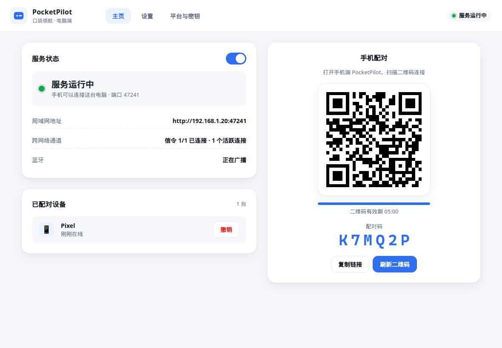
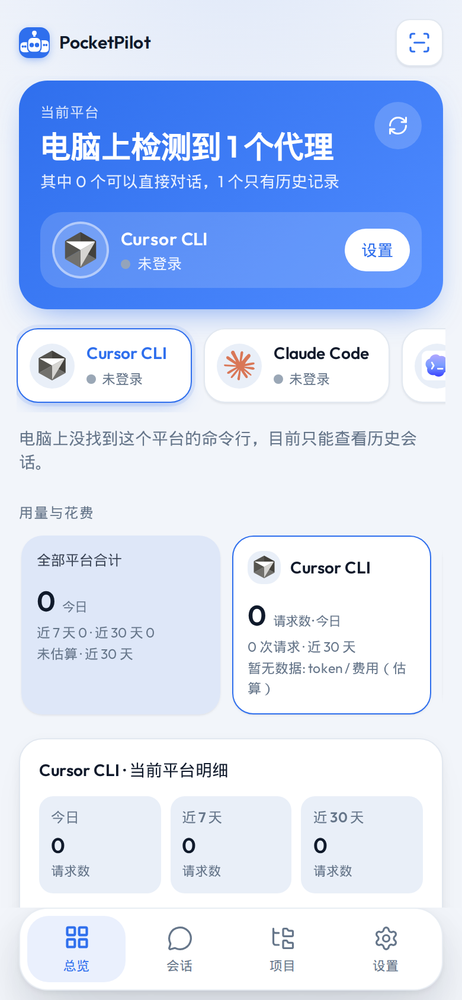
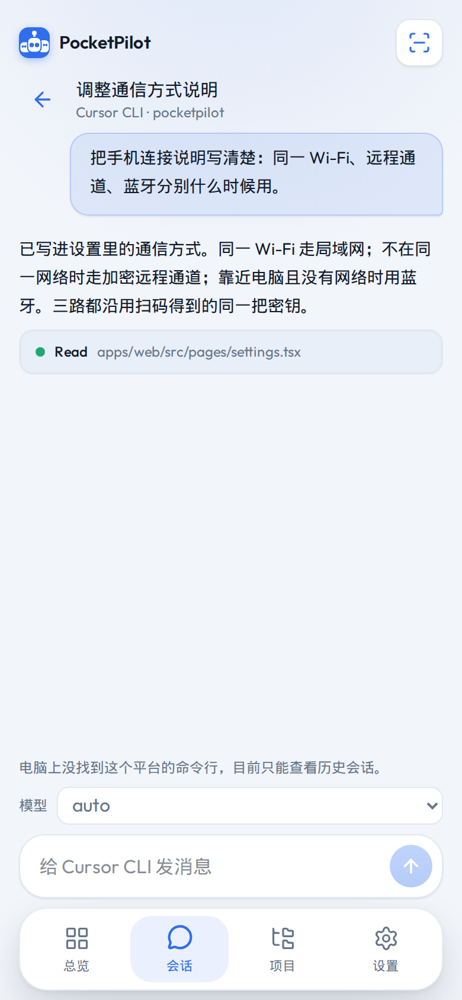

<p align="center">
  English | <a href="./README_CN.md">简体中文</a>
</p>

<p align="center">
  
</p>

<p align="center">
  <b>PocketPilot</b> — a phone remote for the coding agents on your PC
</p>

<p align="center">
  <a href="https://gqqi.github.io/AgentFrame/">Website</a> ·
  <a href="./website/docs/guide.html">Handbook</a> ·
  <a href="./docs/使用指南.md">使用指南</a>
</p>

<p align="center">
  
  
</p>

**PocketPilot（口袋领航）** lets a phone choose an agent, pick a folder, and send a prompt. Cursor CLI, Claude Code, Codex, OpenCode, Gemini CLI, and DeepSeek Harness all run on the computer. Their output streams back to the phone.

The phone can connect over the LAN, an encrypted WebRTC channel, or nearby Bluetooth. Keys from the QR pairing stay on the machine.

**Windows + Android** · dev UI **http://127.0.0.1:47231**

## Screenshots

<p>
  
  
  
</p>

Desktop home, phone home, and a phone chat, in one row. The bilingual site lives in [website/](./website/).

## Quick start

Node.js 22+.

```bash
npm install
npm run dev
```

- UI: http://127.0.0.1:47231
- Host: http://127.0.0.1:47232

```bash
npm test
npm run typecheck
npm run build
npm start          # this PC only
npm run host       # LAN, pairing required
```

## Build an exe and an apk

Run these from the repository root after `npm install`. Node.js 22+.

### Windows installer (exe)

Build this on Windows:

```powershell
npm run desktop:dist:win
```

`dist-desktop\` then contains:

- `PocketPilot-Setup-<version>.exe` — NSIS installer, optional folder, desktop shortcut
- `PocketPilot-Portable-<version>.zip` — unpack and run `PocketPilot.exe`

If Node 20 reports `ERR_REQUIRE_ESM`, set `$env:NODE_OPTIONS="--experimental-require-module"` first. Node 22 does not need that. If the Electron download is blocked:

```powershell
$env:ELECTRON_MIRROR="https://npmmirror.com/mirrors/electron/"
$env:ELECTRON_BUILDER_BINARIES_MIRROR="https://npmmirror.com/mirrors/electron-builder-binaries/"
```

The installer is unsigned. Windows may say it protected your PC; choose More info → Run anyway.

### Android APK

You need JDK 17 and an Android SDK with platform-tools, `platforms;android-34`, and `build-tools;34.0.0`. The script uses `JAVA_HOME` and `ANDROID_HOME` when they are set, otherwise `%USERPROFILE%\jdk-17` and `%USERPROFILE%\android-sdk`. It does not change system environment variables. `JAVA_HOME` must be a JDK 17 path.

```powershell
npm run android:debug
```

Output: `dist-android\PocketPilot-debug.apk`.

For a release APK, put the keystore at `release\keystore\pocketpilot-release.keystore` and the password in `release\keystore\pocketpilot-release.keystore.password.txt` (one password, or `alias=` / `storePassword=` / `keyPassword=` lines). Do not commit either file. You can point elsewhere with `POCKETPILOT_KEYSTORE` and `POCKETPILOT_KEYSTORE_PASSWORD_FILE`.

```powershell
$env:POCKETPILOT_KEYSTORE="C:\path\to\pocketpilot-release.keystore"
$env:POCKETPILOT_KEYSTORE_PASSWORD_FILE="C:\path\to\password.txt"
npm run android:release
```

Output: `dist-android\PocketPilot-release.apk`. An unsigned release APK is not produced.

## Connect a phone

1. On Windows, `npm run desktop:dist:win` writes `PocketPilot-Setup-*.exe` and a portable zip under `dist-desktop\`.
2. Open **PocketPilot**. The window shows the service, LAN address, remote channel, Bluetooth, a QR code, and a 6-digit pairing code.
3. `npm run android:debug` writes `dist-android\PocketPilot-debug.apk`. Scan the QR. On the same Wi-Fi you can enter `http://<pc-ip>:47241` plus the code.

After pairing, the phone tries LAN HTTP, then the encrypted remote channel, then Bluetooth. Settings → 通信方式 can force one path. **Allow Bluetooth** on the desktop restarts the service.

Bluetooth advertising uses Windows `GattServiceProvider` (Windows 10 1803+, system Bluetooth on). It does not replace the inbox Bluetooth driver. Other desktops keep LAN and WebRTC and show “Windows only” for Bluetooth.

## Agents

| Adapter | Command | Live prompt |
| --- | --- | --- |
| Cursor CLI | `agent` | `agent -p` |
| Claude Code | `claude` | `claude -p --model` |
| Codex | `codex` | `codex exec --skip-git-repo-check` |
| OpenCode | `opencode` | `opencode run` |
| Gemini CLI | `gemini` | `gemini -p -m` |
| DeepSeek Harness | `dsh` | `dsh --profile headless` |

Demo mode is the default, so neither side needs a CLI installed. Turn it off and the host probes the commands and runs them in the folder you picked.

A new backend implements `AgentAdapter` (`packages/agent-core/src/hub.ts`) and calls `registerAdapter` before `createHub`. Built-ins are listed in `packages/agent-core/src/catalog.ts`.

## Layout

```text
apps/web        Vite + React phone UI
apps/bridge     Host on the PC
apps/desktop    Electron shell
apps/android    Capacitor APK
packages/agent-core
packages/remote       LAN, WebRTC, and Bluetooth transports
website/              This product site
```

Keys never go into git. Environment variables win; otherwise they are stored in `~/.pocketpilot/secrets.json` (mode `0600`). `MOBILEAGENT_*` still maps to `POCKETPILOT_*`. The first launch copies `~/.mobileagent` to `~/.pocketpilot`.

Longer install, pairing, and revoke steps: [docs/使用指南.md](docs/使用指南.md).
