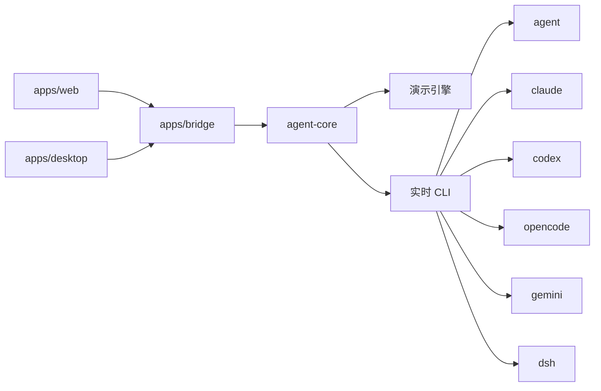

# MobileAgent

手机优先的多代理控制台。用来查看和推动本机上的编码代理：会话、终端输出、项目文件、排队提示，以及每条线路的连接状态。

界面是深色、暖色的独立视觉，底部导航给手机用，宽屏会变成左侧导航。它不是 CloudCLI / Claude Code UI 的皮肤，也不包含那份代码。

VS Code 不是这里的代理平台。编辑器只是你自己的工具；MobileAgent 连接的是代理 CLI。

## 代理

| 适配器 | 命令 | 说明 |
| --- | --- | --- |
| Cursor CLI | `agent` | CloudCLI 开源注册表里的 cursor。实时模式跑 `agent -p`。 |
| Claude Code | `claude` | 实时模式跑 `claude -p --model`。 |
| Codex | `codex` | 实时模式跑 `codex exec --skip-git-repo-check`。模型以本机 Codex 配置为准。 |
| OpenCode | `opencode` | CloudCLI 开源注册表里的 opencode。实时模式跑 `opencode run`。 |
| Gemini CLI | `gemini` | CloudCLI 托管文档列出的线路。实时模式跑 `gemini -p -m`。 |
| DeepSeek Harness | `dsh` | 不是普通的 DeepSeek 对话接口。实时模式跑 `dsh --profile headless`。模型写在 dsh 配置档里（示例：`deepseek-v4-pro`、`deepseek-v4-flash`）。 |

默认是演示模式：六条线路都有样例项目、会话、文件和队列，不需要安装 CLI。关掉演示模式后，桥接会探测命令，并在你填写的项目路径里启动对应 CLI。

新的代理实现 `AgentAdapter`（`packages/agent-core/src/hub.ts`），在创建 Hub 之前调用 `registerAdapter`。内置名单来自 `packages/agent-core/src/catalog.ts`。

## 架构

```text
apps/web        Vite + React 界面，手机底部导航，可安装成 PWA
apps/bridge     本机 HTTP 桥接，只绑 127.0.0.1
apps/desktop    Electron 壳，启动桥接并打开窗口
packages/protocol     共享类型
packages/agent-core   适配器、演示引擎、实时 CLI 引擎
```



密钥不会进仓库。环境变量优先；否则写到 `~/.mobileagent/secrets.json`（权限 `0600`）。连接设置在 `~/.mobileagent/settings.json`，不含密钥。

## 本地运行

需要 Node.js 22 或更新版本。

```bash
npm install
npm run dev
```

- 界面：<http://127.0.0.1:47231>
- 桥接：<http://127.0.0.1:47232>

```bash
npm test
npm run build
npm start
```

`npm start` 由桥接托管已经构建的界面，仍然只监听本机。

把仓库同步到 Windows 时，放到 `D:\Project\MobileAgent` 即可，目录就是仓库根目录，没有额外的包装层。

## 接上每条线路

先在设置里关掉演示模式，填好「实时模式的项目路径」，再按需要改命令路径。探测不到命令时，卡片会显示离线，并写出找不到的命令名。

### Cursor CLI

安装 Cursor CLI，让 `agent` 出现在 `PATH` 上。文档：<https://cursor.com/docs/cli/overview>。实时提示使用 `agent -p`。模型保持 `auto` 时不附加 `--model`。

### Claude Code

安装 Claude Code 并完成一次登录。文档：<https://docs.anthropic.com/en/docs/claude-code>。实时提示使用 `claude -p --model <model>`。可选环境变量 `ANTHROPIC_API_KEY`。

### Codex

安装 OpenAI Codex CLI 并登录。文档：<https://developers.openai.com/codex>。实时提示使用 `codex exec --skip-git-repo-check`。模型沿用 Codex 自己的配置，不从界面强行传 flag。可选环境变量 `OPENAI_API_KEY`。

### OpenCode

安装 OpenCode。文档：<https://opencode.ai>。实时提示使用 `opencode run`。模型沿用 OpenCode 的配置。

### Gemini CLI

安装 Gemini CLI。文档：<https://github.com/google-gemini/gemini-cli>。实时提示使用 `gemini -p -m <model>`。密钥读取 `GEMINI_API_KEY`，其次 `GOOGLE_API_KEY`。

### DeepSeek Harness

这是 DeepSeek 的开源 harness，命令是 `dsh`，不是裸的 chat completions。

```bash
npx @deepseek-ai/dsh web
```

上面这条会打开 Harness 自己的 Web UI。MobileAgent 在实时模式调用的是一轮任务：

```bash
dsh --profile headless "任务内容"
```

文档：<https://github.com/deepseek-ai/deepseek-harness>。把 `DEEPSEEK_API_KEY` 放在环境变量里，或在设置页保存到本机。端点会传给子进程的 `DEEPSEEK_BASE_URL`。模型由 dsh 配置档决定，界面里的模型名用来对照，例如 `deepseek-v4-pro` 和 `deepseek-v4-flash`。家目录是 `DSH_HOME`，默认 `~/.dsh`。

Windows 上如果 CLI 是 `.cmd` 垫片，把设置里的命令改成完整路径。

## 安装

### PWA

```bash
npm run build
npm start
```

用 Chrome 或 Edge 打开本机地址，选「安装应用」。`apps/web` 在生产构建里带有 Web App Manifest。开发服务器不注册 service worker，避免把旧界面缓存住。

### Windows 安装包

在 Windows 上，于 `D:\Project\MobileAgent`：

```powershell
powershell -ExecutionPolicy Bypass -File .\scripts\package-windows.ps1
```

或者：

```bash
npm install
npm run desktop:dist:win
```

安装包在 `apps\desktop\release\MobileAgent-Setup-*.exe`（NSIS，可选安装目录）。Electron 会拉起桥接再打开窗口。签名默认关闭，方便在没有证书的机器上打包。

当前这台 Linux 环境可以先打未打包目录：

```bash
npm run desktop:dist
```

没有 Wine 时不要指望在 Linux 上产出 NSIS。脚本已经写好，换到 Windows 上跑即可。

### 桌面壳调试

```bash
npm run desktop
```

这会先构建界面和桥接，再用 Electron 打开。桌面壳使用端口 `47241`，避免和 `npm run dev` 冲突。

## 演示模式里有什么

- 总览：六张代理卡、连接状态、当前会话
- 会话：流式回复、工具轨迹、终端（`pwd` / `ls` / `git status`）
- 项目：文件树、预览、演示用的改动列表和提交记录
- 队列：等待、排序、放行，以及会话历史
- 设置：演示开关、语言、项目路径、命令、模型、端点、密钥、MCP 样例

实时模式的终端会在项目目录里执行命令，桥接只监听 `127.0.0.1`。演示模式不会碰真实文件系统。

截图：

```bash
npm run screenshots
```

需要先开着 `npm run dev`。图片写到 `artifacts/`。

## 环境变量

看 `.env.example`。不要把真实密钥提交进 git。

---

# MobileAgent (English)

Mobile-first control panel for coding-agent CLIs. It keeps sessions, terminal output, project files, queued prompts, and connection health on one phone-sized surface.

The visual language is original: warm ink, lime, and a serif display face, with a bottom dock on phones and a side rail on wider screens. It does not reuse CloudCLI / Claude Code UI code or assets.

VS Code is not an agent backend here.

## Agents

| Adapter | Command | Notes |
| --- | --- | --- |
| Cursor CLI | `agent` | In the CloudCLI open-source provider registry. Live mode runs `agent -p`. |
| Claude Code | `claude` | Live mode runs `claude -p --model`. |
| Codex | `codex` | Live mode runs `codex exec --skip-git-repo-check`. The model stays in the local Codex config. |
| OpenCode | `opencode` | In the CloudCLI open-source provider registry. Live mode runs `opencode run`. |
| Gemini CLI | `gemini` | Listed by CloudCLI's hosted docs. Live mode runs `gemini -p -m`. |
| DeepSeek Harness | `dsh` | Not plain DeepSeek chat. Live mode runs `dsh --profile headless`. The model lives in the dsh profile (`deepseek-v4-pro`, `deepseek-v4-flash` in the upstream examples). |

Demo mode is the default. It ships sample projects, sessions, files, and a queue for all six adapters. Turn it off to probe local CLIs and run them in the project path from Settings.

Add another backend by implementing `AgentAdapter` in `packages/agent-core/src/hub.ts` and calling `registerAdapter` before `createHub`. Built-ins are declared in `packages/agent-core/src/catalog.ts`.

## Layout

`apps/web` is the Vite UI and PWA. `apps/bridge` is a localhost HTTP bridge. `apps/desktop` is an Electron shell that starts the bridge. Shared types live in `packages/protocol`. Demo and live engines live in `packages/agent-core`.

Keys never go into git. Environment variables win; otherwise they are stored in `~/.mobileagent/secrets.json` with mode `0600`.

## Run

Node.js 22+.

```bash
npm install
npm run dev
```

UI: <http://127.0.0.1:47231> · bridge: <http://127.0.0.1:47232>

```bash
npm test
npm run build
npm start
```

Copy the repo to `D:\Project\MobileAgent` on Windows. The repository root is the app root.

## Pointing at each backend

Turn demo mode off, set the live project path, and adjust the command if it is not on `PATH`. A missing binary shows as offline with the command name.

- **Cursor CLI** — <https://cursor.com/docs/cli/overview>. `agent -p`. `--model` is added only when the model is not `auto`.
- **Claude Code** — <https://docs.anthropic.com/en/docs/claude-code>. `claude -p --model`. Optional `ANTHROPIC_API_KEY`.
- **Codex** — <https://developers.openai.com/codex>. `codex exec --skip-git-repo-check`. Optional `OPENAI_API_KEY`.
- **OpenCode** — <https://opencode.ai>. `opencode run`.
- **Gemini CLI** — <https://github.com/google-gemini/gemini-cli>. `gemini -p -m`. `GEMINI_API_KEY`, then `GOOGLE_API_KEY`.
- **DeepSeek Harness** — <https://github.com/deepseek-ai/deepseek-harness>. Their own UI is `npx @deepseek-ai/dsh web`. MobileAgent calls `dsh --profile headless "<task>"`. Set `DEEPSEEK_API_KEY`. A non-empty endpoint is passed as `DEEPSEEK_BASE_URL`. Home defaults to `~/.dsh` (`DSH_HOME`).

On Windows, if the CLI is a `.cmd` shim, paste the full path into the command field.

## Install

PWA: `npm run build && npm start`, then use the browser's install action. The manifest is emitted by the production build.

Windows installer, from `D:\Project\MobileAgent`:

```powershell
powershell -ExecutionPolicy Bypass -File .\scripts\package-windows.ps1
```

The NSIS package is written to `apps\desktop\release`. `npm run desktop:dist` builds an unpacked Linux directory in this environment. Producing NSIS wants Windows (or Wine); the script is ready either way.

`npm run desktop` builds the UI and bridge, then opens Electron on port `47241`.

Screenshots of the main flows (with `npm run dev` already running):

```bash
npm run screenshots
```

Files land in `artifacts/`.
