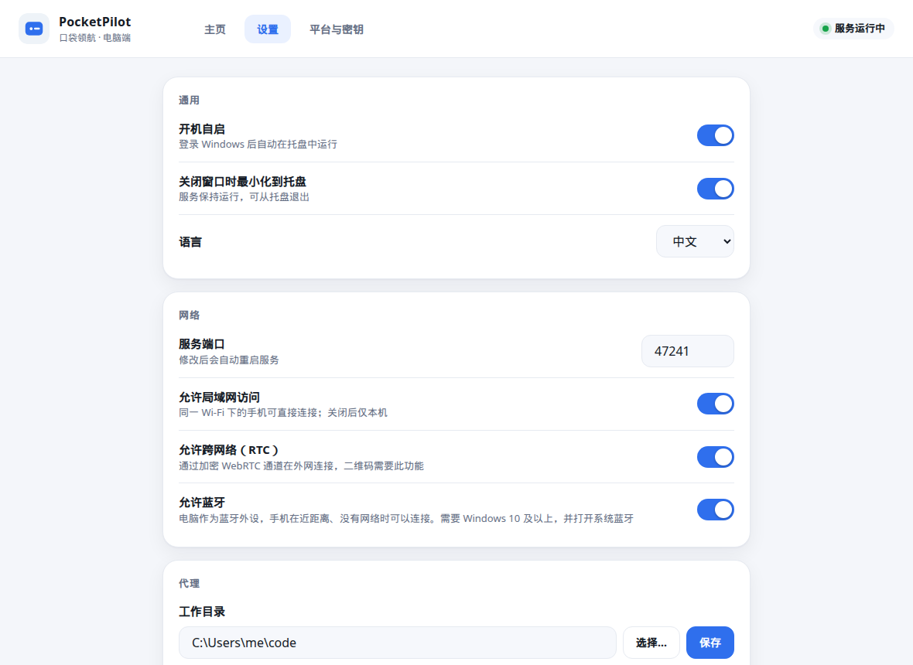
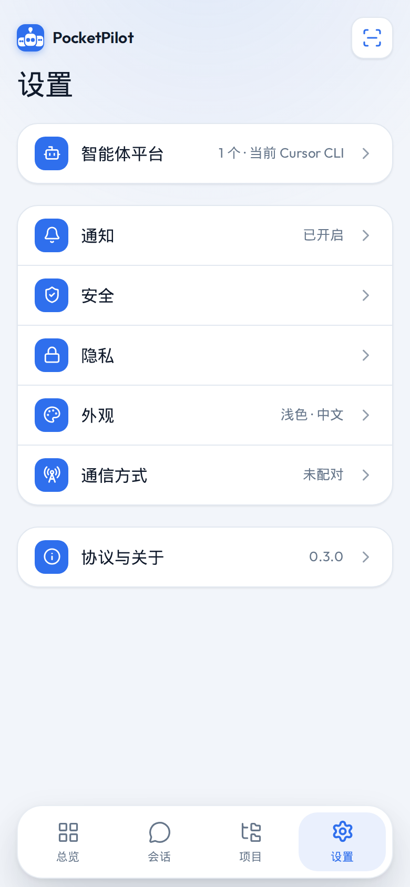

<p align="center">
  <a href="./README.md">English</a> | 简体中文
</p>

<p align="center">
  
</p>

<p align="center">
  <b>PocketPilot 口袋领航</b> — 用手机遥控电脑上的编码代理
</p>

<p align="center">
  <a href="https://gqqi.github.io/AgentFrame/">产品网页</a> ·
  <a href="./website/docs/guide.html">使用手册</a> ·
  <a href="./docs/使用指南.md">安装细则</a>
</p>

<p align="center">
  
  
</p>

手机负责挑选和下指令。Cursor CLI、Claude Code、Codex、OpenCode、Gemini CLI 和 DeepSeek Harness 都跑在电脑上，输出再流回手机。

连接按这个顺序自动选择：同一 Wi-Fi 的局域网 HTTP → 加密远程通道（WebRTC）→ 近距离蓝牙。密钥来自同一次扫码配对，留在这台电脑上。

**Windows + Android** · 开发界面 **http://127.0.0.1:47231**

## 截图





产品页在 [website/](./website/)。

## 快速开始

需要 Node.js 22 或更新版本。

```bash
npm install
npm run dev
```

- 界面：http://127.0.0.1:47231
- 宿主：http://127.0.0.1:47232

```bash
npm test
npm run typecheck
npm run build
npm start          # 只监听本机
npm run host       # 局域网，并要求配对
```

## 让手机连上电脑

1. 在 Windows 上执行 `npm run desktop:dist:win`，`dist-desktop\` 里会有安装包和便携版。
2. 打开 **PocketPilot 口袋领航**。窗口里有服务状态、局域网地址、远程通道、蓝牙、二维码和 6 位配对码。
3. `npm run android:debug` 产出 `dist-android\PocketPilot-debug.apk`。扫码连接；同一 Wi-Fi 也可以填 `http://电脑IP:47241` 加配对码。

配对之后，手机按局域网、远程通道、蓝牙的顺序连接。设置 → 通信方式可以改成手动。桌面端的「允许蓝牙」会重启服务。

蓝牙广播用 Windows 自带的 `GattServiceProvider`（Windows 10 1803 及以上，系统蓝牙打开）。不要换成 WinUSB。其他系统只提供局域网和远程通道，蓝牙显示「仅 Windows」。

## 代理

| 适配器 | 命令 | 实时模式 |
| --- | --- | --- |
| Cursor CLI | `agent` | `agent -p` |
| Claude Code | `claude` | `claude -p --model` |
| Codex | `codex` | `codex exec --skip-git-repo-check` |
| OpenCode | `opencode` | `opencode run` |
| Gemini CLI | `gemini` | `gemini -p -m` |
| DeepSeek Harness | `dsh` | `dsh --profile headless` |

默认是演示模式，手机和开发机都不必先装 CLI。关掉演示模式后，宿主在你选的目录里探测并启动对应命令。

新代理实现 `AgentAdapter`（`packages/agent-core/src/hub.ts`），在 `createHub` 之前调用 `registerAdapter`。内置名单在 `packages/agent-core/src/catalog.ts`。

## 目录

```text
apps/web            手机界面（Vite + React）
apps/bridge         电脑上的宿主
apps/desktop        Electron 壳
apps/android        Capacitor APK
packages/agent-core 适配器
packages/remote     局域网、WebRTC、蓝牙
website/            产品网页
```

密钥不会进仓库。环境变量优先，否则写到 `~/.pocketpilot/secrets.json`（权限 `0600`）。`MOBILEAGENT_*` 仍等同 `POCKETPILOT_*`。首次启动会把 `~/.mobileagent` 复制到 `~/.pocketpilot`。

安装、配对、撤销设备的逐步说明见 [docs/使用指南.md](docs/使用指南.md)。
