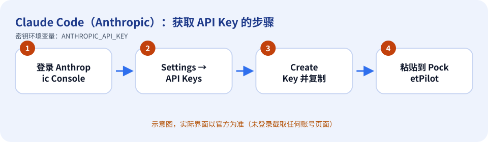
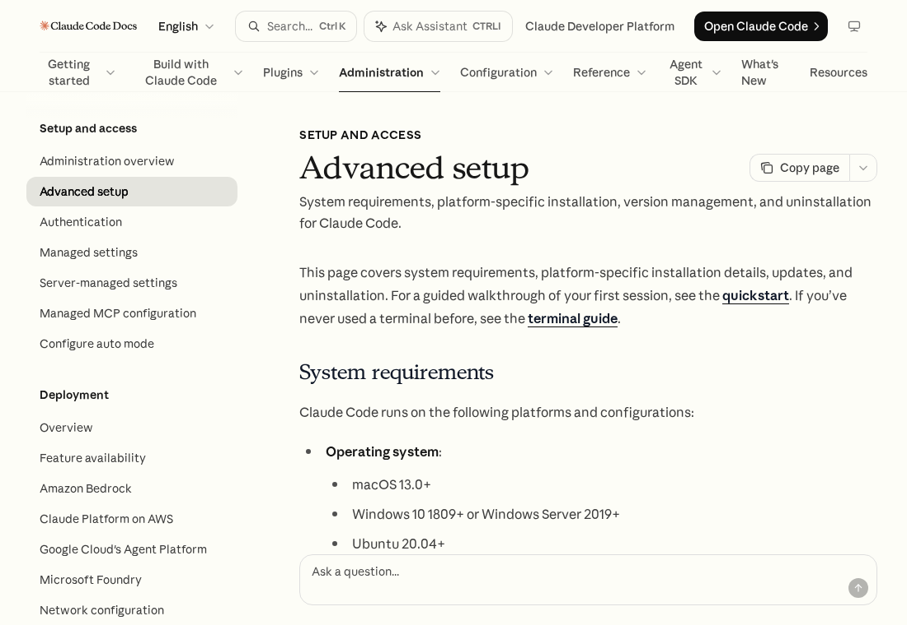

# Claude Code（Anthropic）：如何获取 API Key

> 内容依据官方文档：https://docs.claude.com/en/docs/claude-code/setup（查证日期 2026-10-11）。官方页面会改版，按钮名称以你看到的官方界面为准。

## 先登录

在电脑上打开 `claude`，输入 `/login`，用订阅或 CLI 登录。PocketPilot 认 `~/.claude` 里的登录（凭据文件或 Claude 自己的 settings）。已经登录时，**不会**把保存的 `ANTHROPIC_API_KEY` 传给 Claude Agent SDK 或 `claude` 进程。

API Key 只是备用：没登录、并且你在 PocketPilot 里保存了密钥时才会用它。官方文档仍要求 Pro、Max、Team、Enterprise 或 Console 账号；免费的 claude.ai 套餐不包含 Claude Code。

## 获取步骤

1. 登录 Anthropic Console（https://platform.claude.com ，原 console.anthropic.com）。
2. 进入 **Settings → API Keys**（直达 https://platform.claude.com/settings/keys）。
3. 点击 **Create Key**，起一个便于识别的名字（例如 pocketpilot-pc）。
4. 复制密钥（通常只在创建时显示一次）。
5. 回到 PocketPilot →「平台与密钥」→ Claude Code：粘贴 → 保存 → 测试连接。

*上图是示意图（自绘），不是官方界面截图。*

*上图是**真实截图**：官方公开文档页面 https://docs.claude.com/en/docs/claude-code/setup （无需登录即可看到，未包含任何账号信息）。*

## 免费还是付费

Console 的 API Key **按 token 付费**（需先绑定付款方式/充值）。若你已订阅 Pro/Max，直接 `claude` 登录即可，不必创建 API Key。

## 保密注意事项

- 把密钥当作密码：不要发到聊天群、工单、截图，也不要提交到 Git。
- PocketPilot 只把密钥保存在这台电脑的 `~/.pocketpilot` 下（仅当前用户可读），**不会同步到手机、不会写入日志**，界面上只显示最后 4 位。
- 给每台电脑/用途创建独立的密钥，方便单独吊销；有额度/权限限制选项时尽量收紧。

## 泄露后怎么吊销

在 Console 的 API Keys 页面删除或停用该密钥；然后在 PocketPilot 点「删除」。

## 补充

本指南的步骤来自官方 Claude Code 文档；Console 页面需要登录，**本指南没有登录截取**，界面文字以官方当前版本为准。

## 官方链接

- 官方文档：https://docs.claude.com/en/docs/claude-code/setup
- 控制台/入口：https://platform.claude.com/settings/keys
