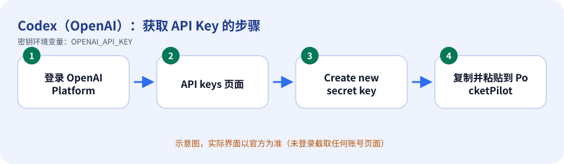
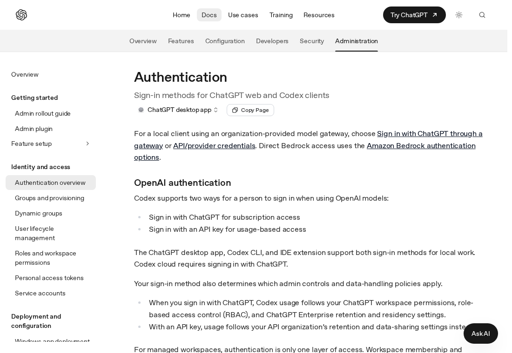

# Codex（OpenAI）：如何获取 API Key

> 内容依据官方文档：https://developers.openai.com/codex/auth（查证日期 2026-10-11）。官方页面会改版，按钮名称以你看到的官方界面为准。

## 先登录

在电脑上运行 `codex login`（Sign in with ChatGPT）。PocketPilot 看到 `~/.codex/auth.json` 就用这个登录，**不会**把保存的 `OPENAI_API_KEY` 传给 `codex`。

API Key 只是备用：没有 `auth.json`、并且你保存了密钥时才会用 `OPENAI_API_KEY`。不必为了用 Codex 去填密钥。

## 获取步骤

1. 登录 OpenAI Platform（https://platform.openai.com）。
2. 打开 API keys 页面（https://platform.openai.com/api-keys）。
3. 点击 **Create new secret key**，命名后创建。
4. 立即复制并妥善保存（官方快速入门建议把密钥存放在安全位置）。
5. 回到 PocketPilot →「平台与密钥」→ Codex：粘贴 → 保存 → 测试连接。

*上图是示意图（自绘），不是官方界面截图。*

*上图是**真实截图**：官方公开文档页面 https://developers.openai.com/codex/auth （无需登录即可看到，未包含任何账号信息）。*

## 免费还是付费

官方文档：API Key 的用量按标准 API 价格从你的 OpenAI Platform 账户计费，不使用 ChatGPT 套餐里的额度。快速入门提到可先做免费测试请求，更高额度需要在 Billing 充值。

## 保密注意事项

- 把密钥当作密码：不要发到聊天群、工单、截图，也不要提交到 Git。
- PocketPilot 只把密钥保存在这台电脑的 `~/.pocketpilot` 下（仅当前用户可读），**不会同步到手机、不会写入日志**，界面上只显示最后 4 位。
- 给每台电脑/用途创建独立的密钥，方便单独吊销；有额度/权限限制选项时尽量收紧。

## 泄露后怎么吊销

在 API keys 页面删除该密钥；若密钥已泄露，请同时检查 Usage 页面是否有异常调用。然后在 PocketPilot 点「删除」。

## 补充

官方命令行写法：`printenv OPENAI_API_KEY | codex login --with-api-key`。注意 `~/.codex/auth.json` 同样含登录凭据，要像密码一样保管。

## 官方链接

- 官方文档：https://developers.openai.com/codex/auth
- 控制台/入口：https://platform.openai.com/api-keys
