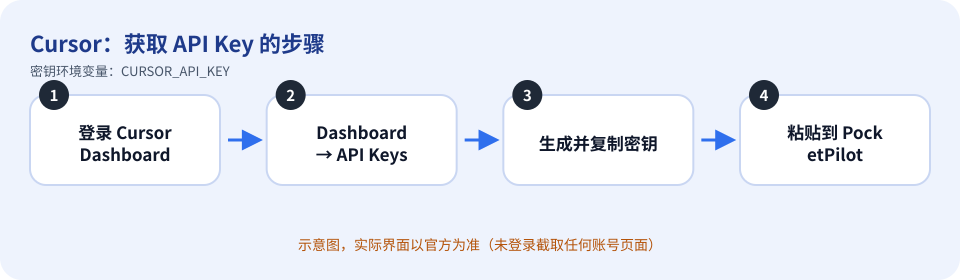
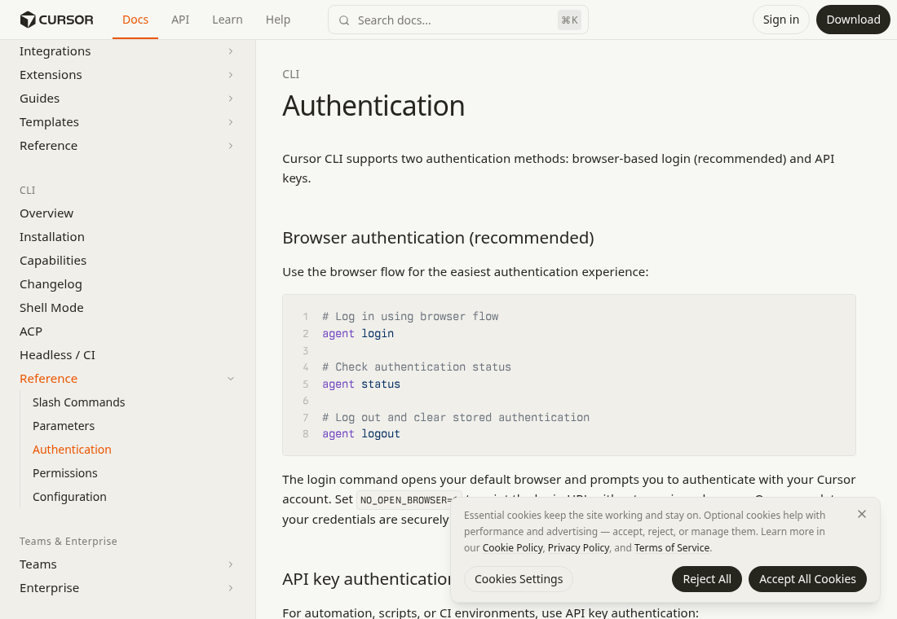

# Cursor：如何获取 API Key

> 内容依据官方文档：https://cursor.com/docs/cli/reference/authentication（查证日期 2026-10-11）。官方页面会改版，按钮名称以你看到的官方界面为准。

## 先登录

在电脑上运行 `cursor-agent login`，用浏览器完成登录。PocketPilot 会看 `cursor-agent status`：已经登录就直接用这个登录态，**不会**把保存的 `CURSOR_API_KEY` 传给子进程。

API Key 只是备用。只有 `cursor-agent status` 显示未登录、并且你在 PocketPilot 里保存了密钥时，才会把 `CURSOR_API_KEY` 交给命令行。不必为了用 Cursor 去填密钥。

## 获取步骤

1. 用浏览器打开 Cursor Dashboard（https://cursor.com/dashboard）并登录你的 Cursor 账号。
2. 按官方文档的说法进入 **Dashboard → API Keys**，生成一个 user API key。
3. 复制生成的密钥（请立刻保存，之后通常无法再次查看完整内容）。
4. 回到 PocketPilot 桌面程序 → 「平台与密钥」→ Cursor：粘贴（或从文本文件导入）→ 保存 → 测试连接。

*上图是示意图（自绘），不是官方界面截图。*

*上图是**真实截图**：官方公开文档页面 https://cursor.com/docs/cli/reference/authentication （无需登录即可看到，未包含任何账号信息）。*

## 免费还是付费

官方 CLI 文档没有为 API Key 单独标价；用量按你的 Cursor 账号/套餐计算。免费或付费额度以 https://cursor.com/pricing 为准。

## 保密注意事项

- 把密钥当作密码：不要发到聊天群、工单、截图，也不要提交到 Git。
- PocketPilot 只把密钥保存在这台电脑的 `~/.pocketpilot` 下（仅当前用户可读），**不会同步到手机、不会写入日志**，界面上只显示最后 4 位。
- 给每台电脑/用途创建独立的密钥，方便单独吊销；有额度/权限限制选项时尽量收紧。

## 泄露后怎么吊销

回到生成密钥的 Dashboard → API Keys 页面，删除/撤销该密钥（按钮名称以官方当前界面为准），必要时再生成新密钥；然后在 PocketPilot 点「删除」。

## 补充

命令行等价写法（来自官方文档）：`export CURSOR_API_KEY=你的密钥` 后运行 `agent -p "…"`，或 `agent --api-key 你的密钥`（不推荐，密钥会出现在进程列表/历史里）。

## 官方链接

- 官方文档：https://cursor.com/docs/cli/reference/authentication
- 控制台/入口：https://cursor.com/dashboard
