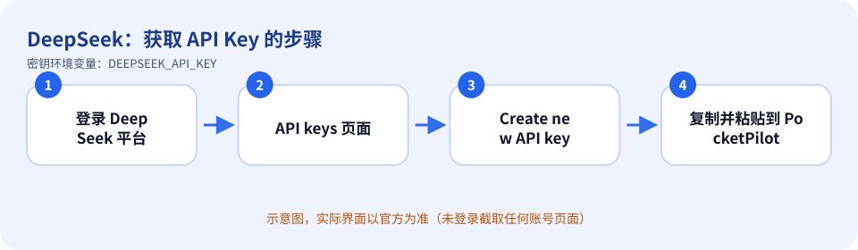
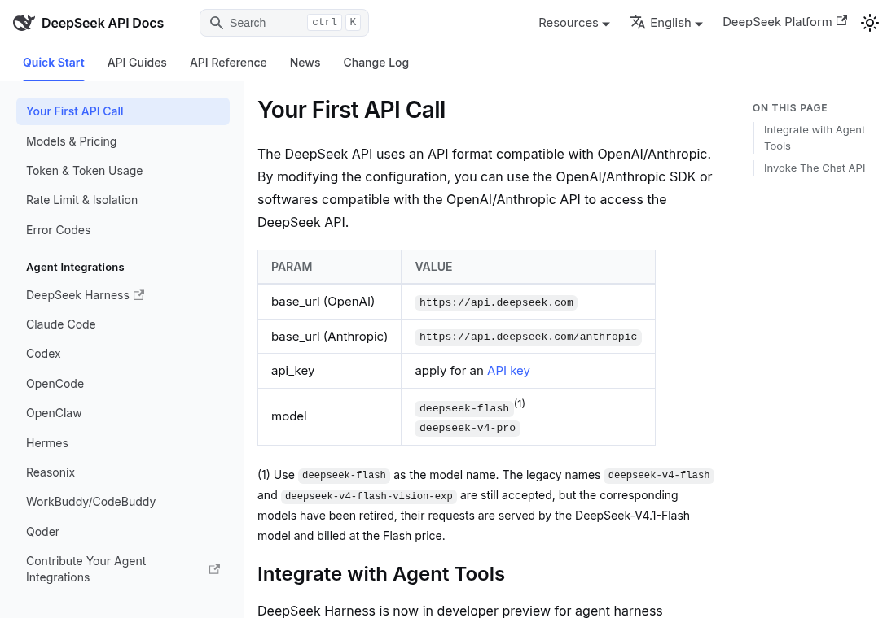

# DeepSeek：如何获取 API Key

> 内容依据官方文档：https://api-docs.deepseek.com/（查证日期 2026-10-11）。官方页面会改版，按钮名称以你看到的官方界面为准。

## 这个平台没有命令行登录

DeepSeek Harness（`dsh`）没有像 `cursor-agent login` 那样的本机登录。对话需要 `DEEPSEEK_API_KEY`，这不是可选备用。官方文档在 “Your First API Call” 里说明要先申请 API key（base URL `https://api.deepseek.com`）。

## 获取步骤

1. 打开 DeepSeek 开放平台 https://platform.deepseek.com ，注册/登录。
2. 进入 **API keys** 页面，点击 **Create new API key**（OpenCode 官方文档对该步骤的描述同为 Create new API key）。
3. 复制密钥并保存。
4. 回到 PocketPilot →「平台与密钥」→ DeepSeek：粘贴 → 保存 → 测试连接。

*上图是示意图（自绘），不是官方界面截图。*

*上图是**真实截图**：官方公开文档页面 https://api-docs.deepseek.com/ （无需登录即可看到，未包含任何账号信息）。*

## 免费还是付费

按量计费（官方文档提到按模型价格计费，如 Flash 模型按 Flash 价格）；具体单价与是否有赠送额度以官方定价页为准。

## 保密注意事项

- 把密钥当作密码：不要发到聊天群、工单、截图，也不要提交到 Git。
- PocketPilot 只把密钥保存在这台电脑的 `~/.pocketpilot` 下（仅当前用户可读），**不会同步到手机、不会写入日志**，界面上只显示最后 4 位。
- 给每台电脑/用途创建独立的密钥，方便单独吊销；有额度/权限限制选项时尽量收紧。

## 泄露后怎么吊销

在 API keys 页面删除该密钥（按钮名称以官方界面为准），再创建新的；PocketPilot 里点「删除」。

## 补充

官方文档还说明可以把 DeepSeek 作为 Claude Code、OpenCode 等工具的后端模型（Agent Integrations Guide）。

## 官方链接

- 官方文档：https://api-docs.deepseek.com/
- 控制台/入口：https://platform.deepseek.com/api_keys
