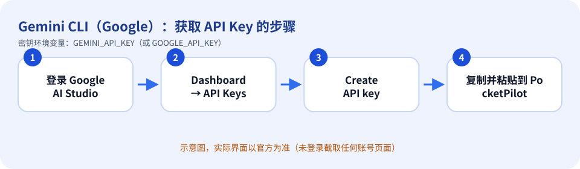
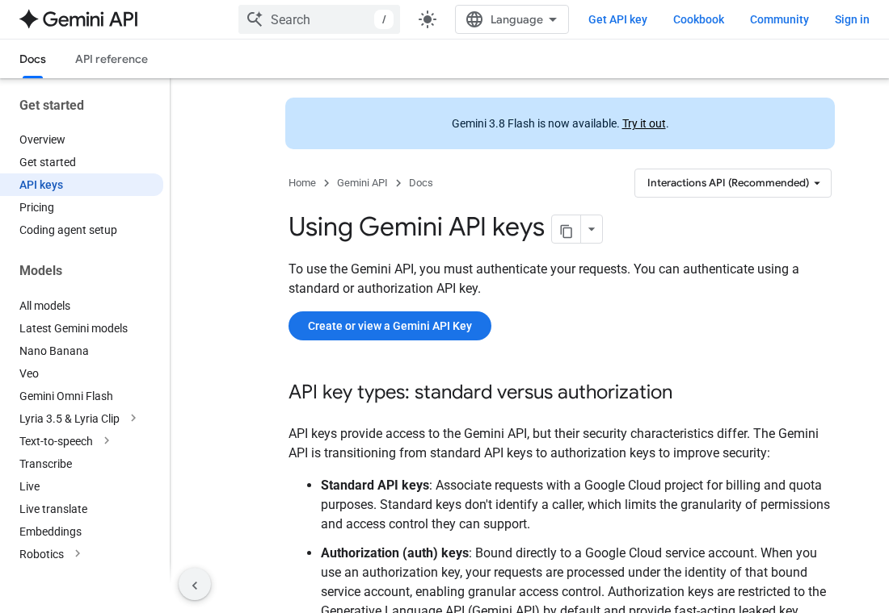

# Gemini CLI（Google）：如何获取 API Key

> 内容依据官方文档：https://ai.google.dev/gemini-api/docs/api-key（查证日期 2026-10-11）。官方页面会改版，按钮名称以你看到的官方界面为准。

## 先确认：你需要 API Key 吗？

Gemini CLI 可用 Google 账号登录，也可用 Gemini API Key。官方文档：客户端库会自动读取环境变量 `GEMINI_API_KEY` 或 `GOOGLE_API_KEY`（两者都设置时 `GOOGLE_API_KEY` 优先）。

## 获取步骤

1. 打开 Google AI Studio（https://aistudio.google.com）并用 Google 账号登录，接受服务条款。
2. 新用户会自动得到一个默认 Google Cloud 项目和 API key；已有 Cloud 账号则需要在 Dashboard → Projects 里 **Import projects**。
3. 打开 Dashboard 的 **API Keys** 页面，点击 **Create API key**（官方：自 2026-05-28 起新建的密钥默认是 auth key）。
4. 复制密钥。
5. 回到 PocketPilot →「平台与密钥」→ Gemini：粘贴 → 保存 → 测试连接。

*上图是示意图（自绘），不是官方界面截图。*

*上图是**真实截图**：官方公开文档页面 https://ai.google.dev/gemini-api/docs/api-key （无需登录即可看到，未包含任何账号信息）。*

## 免费还是付费

每个密钥属于一个 Google Cloud 项目，计费与配额按项目计算。免费额度与价格以官方 Pricing 页面为准（本指南不作具体数字承诺）。

## 保密注意事项

- 把密钥当作密码：不要发到聊天群、工单、截图，也不要提交到 Git。
- PocketPilot 只把密钥保存在这台电脑的 `~/.pocketpilot` 下（仅当前用户可读），**不会同步到手机、不会写入日志**，界面上只显示最后 4 位。
- 给每台电脑/用途创建独立的密钥，方便单独吊销；有额度/权限限制选项时尽量收紧。

## 泄露后怎么吊销

官方泄露应对清单：①创建新密钥 ②更新使用方 ③在 Cloud 控制台禁用/删除泄露的密钥（确认新密钥可用后）④检查账单与用量日志。官方还建议设置账单提醒，并给密钥加 API/IP 限制。

## 补充

官方安全提示：不要把密钥提交到 Git，也不要写进客户端（网页/手机 App）代码里。

## 官方链接

- 官方文档：https://ai.google.dev/gemini-api/docs/api-key
- 控制台/入口：https://aistudio.google.com/apikey
