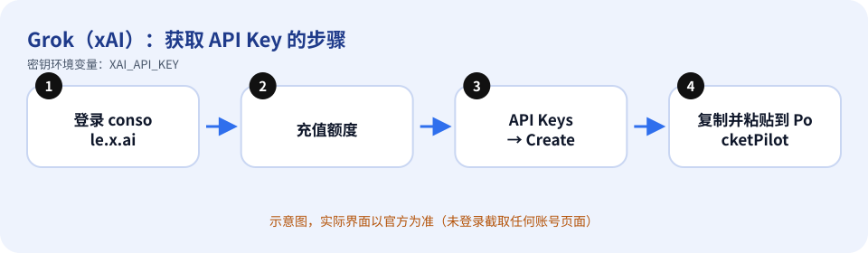
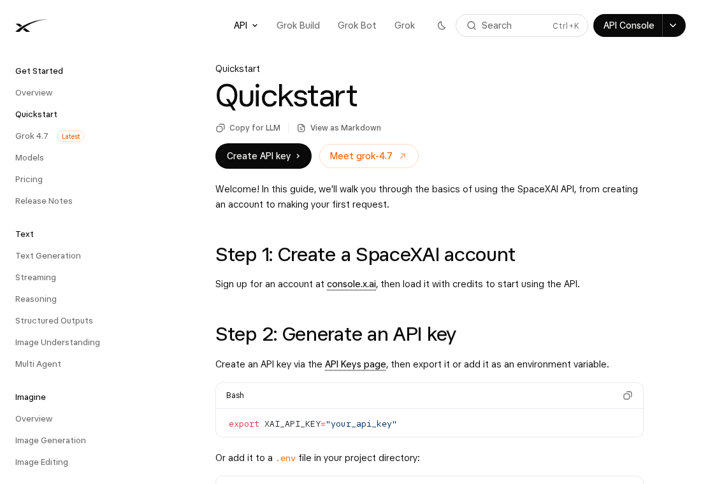

# Grok（xAI）：如何获取 API Key

> 内容依据官方文档：https://docs.x.ai/docs/tutorial（查证日期 2026-10-11）。官方页面会改版，按钮名称以你看到的官方界面为准。

## 先确认：你需要 API Key 吗？

PocketPilot 的 Grok 适配器走 xAI API（`https://api.x.ai/v1`），**需要 `XAI_API_KEY`**，不依赖本机安装 grok 命令行。设置了密钥后该平台即视为可用。

## 获取步骤

1. 打开 xAI 控制台 https://console.x.ai 并注册/登录账号。
2. 按官方快速入门：先给账号充值额度（官方原话：load it with credits）。
3. 在控制台的 **API Keys** 页面创建一个 API key。
4. 复制密钥并妥善保存（官方示例用环境变量 `XAI_API_KEY`）。
5. 回到 PocketPilot →「平台与密钥」→ Grok：粘贴 → 保存 → 测试连接（会请求 `GET https://api.x.ai/v1/models`）。

*上图是示意图（自绘），不是官方界面截图。*

*上图是**真实截图**：官方公开文档页面 https://docs.x.ai/docs/tutorial （无需登录即可看到，未包含任何账号信息）。*

## 免费还是付费

**付费**：API 按用量从充值额度中扣费，没有额度时请求会被拒绝。价格见官方 Models / Pricing 页面。

## 保密注意事项

- 把密钥当作密码：不要发到聊天群、工单、截图，也不要提交到 Git。
- PocketPilot 只把密钥保存在这台电脑的 `~/.pocketpilot` 下（仅当前用户可读），**不会同步到手机、不会写入日志**，界面上只显示最后 4 位。
- 给每台电脑/用途创建独立的密钥，方便单独吊销；有额度/权限限制选项时尽量收紧。

## 泄露后怎么吊销

在 console.x.ai 的 API Keys 页面删除该密钥（按钮名称以官方界面为准），再创建新密钥；PocketPilot 里点「删除」清除本地副本。

## 补充

官方还提供 xAI SDK / OpenAI 兼容接口（base URL `https://api.x.ai/v1`），PocketPilot 用的就是这个兼容接口。

## 官方链接

- 官方文档：https://docs.x.ai/docs/tutorial
- 控制台/入口：https://console.x.ai
