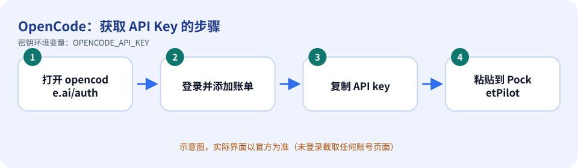
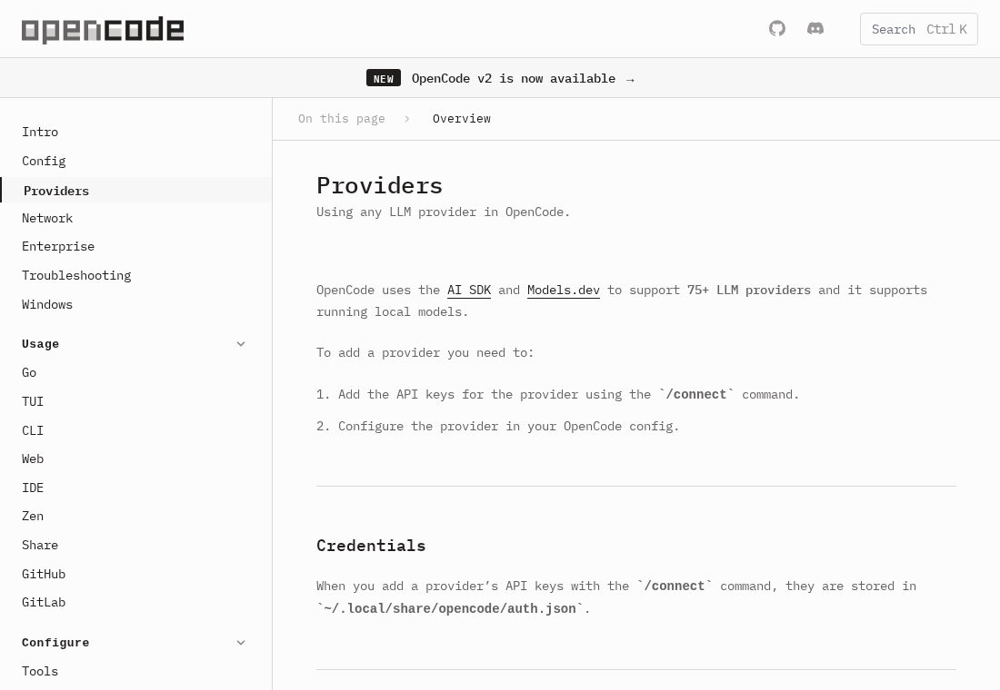

# OpenCode：如何获取 API Key

> 内容依据官方文档：https://opencode.ai/docs/providers/（查证日期 2026-10-11）。官方页面会改版，按钮名称以你看到的官方界面为准。

## 先确认：你需要 API Key 吗？

OpenCode 自己通过 `/connect` 命令保存各模型提供商的凭据（存放在 `~/.local/share/opencode/auth.json`），你也可以直接使用它的任意提供商。PocketPilot 的密钥栏对应的是 **OpenCode Zen** 的密钥（`OPENCODE_API_KEY`），这是可选项。

## 获取步骤

1. 在 OpenCode 里运行 `/connect`，选择 OpenCode Zen，会指向 https://opencode.ai/auth 。
2. 登录该页面，**添加账单信息**，复制你的 API key（官方原话：Sign in, add your billing details, and copy your API key）。
3. 回到 PocketPilot →「平台与密钥」→ OpenCode：粘贴 → 保存 → 测试连接。

*上图是示意图（自绘），不是官方界面截图。*

*上图是**真实截图**：官方公开文档页面 https://opencode.ai/docs/providers/ （无需登录即可看到，未包含任何账号信息）。*

## 免费还是付费

OpenCode Zen 需要绑定账单信息（按用量）；OpenCode Go 是低价订阅方案。具体价格以官方为准。

## 保密注意事项

- 把密钥当作密码：不要发到聊天群、工单、截图，也不要提交到 Git。
- PocketPilot 只把密钥保存在这台电脑的 `~/.pocketpilot` 下（仅当前用户可读），**不会同步到手机、不会写入日志**，界面上只显示最后 4 位。
- 给每台电脑/用途创建独立的密钥，方便单独吊销；有额度/权限限制选项时尽量收紧。

## 泄露后怎么吊销

在 opencode.ai 账户页删除/重置该密钥（以官方界面为准）；OpenCode 自己保存的凭据可在其 `/connect` 流程里重新设置。

## 补充

若你使用的是别的提供商（Anthropic、OpenAI、DeepSeek 等），请按那些平台的指南获取密钥，再用 `/connect` 交给 OpenCode。

## 官方链接

- 官方文档：https://opencode.ai/docs/providers/
- 控制台/入口：https://opencode.ai/auth
