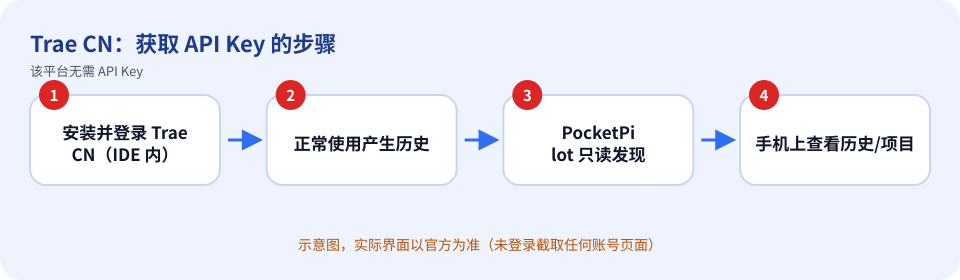

# Trae CN：如何获取 API Key

> 内容依据官方文档：https://www.trae.cn/（查证日期 2026-10-11）。官方页面会改版，按钮名称以你看到的官方界面为准。

## 先确认：你需要 API Key 吗？

Trae CN 是桌面 IDE，没有公开的 API Key 机制，PocketPilot 对它**不需要也不保存密钥**。PocketPilot 只以**只读**方式读取本机 `%APPDATA%\Trae CN` 下的历史会话与项目，用于在手机上查看；对话请在 Trae CN 里进行。

## 获取步骤

1. 在电脑上安装并打开 Trae CN，用你的 Trae 账号登录（登录在 IDE 内完成，PocketPilot 不接触账号）。
2. 正常使用后，PocketPilot 会自动发现 `%APPDATA%\Trae CN` 里的项目和历史。
3. 手机端「平台」列表中的 Trae CN 会显示为「仅历史」。

*上图是示意图（自绘），不是官方界面截图。*

## 免费还是付费

Trae CN 的免费/付费政策由官方决定，请查看 https://www.trae.cn/ 。PocketPilot 本身不收费也不代理其请求。

## 保密注意事项

- 把密钥当作密码：不要发到聊天群、工单、截图，也不要提交到 Git。
- PocketPilot 只把密钥保存在这台电脑的 `~/.pocketpilot` 下（仅当前用户可读），**不会同步到手机、不会写入日志**，界面上只显示最后 4 位。
- 给每台电脑/用途创建独立的密钥，方便单独吊销；有额度/权限限制选项时尽量收紧。

## 泄露后怎么吊销

无 API Key 可吊销。如需断开，只要不再使用即可；想让 PocketPilot 不再读取，可在设置→隐私里关闭历史记录或卸载桌面程序。

## 补充

本页没有官方文档截图：官网首页不含获取密钥的步骤，且本指南未对 Trae CN 的内部存储格式做任何官方担保（仅本地只读解析，可能随版本变化）。

## 官方链接

- 官方文档：https://www.trae.cn/
- 控制台/入口：https://www.trae.cn/
